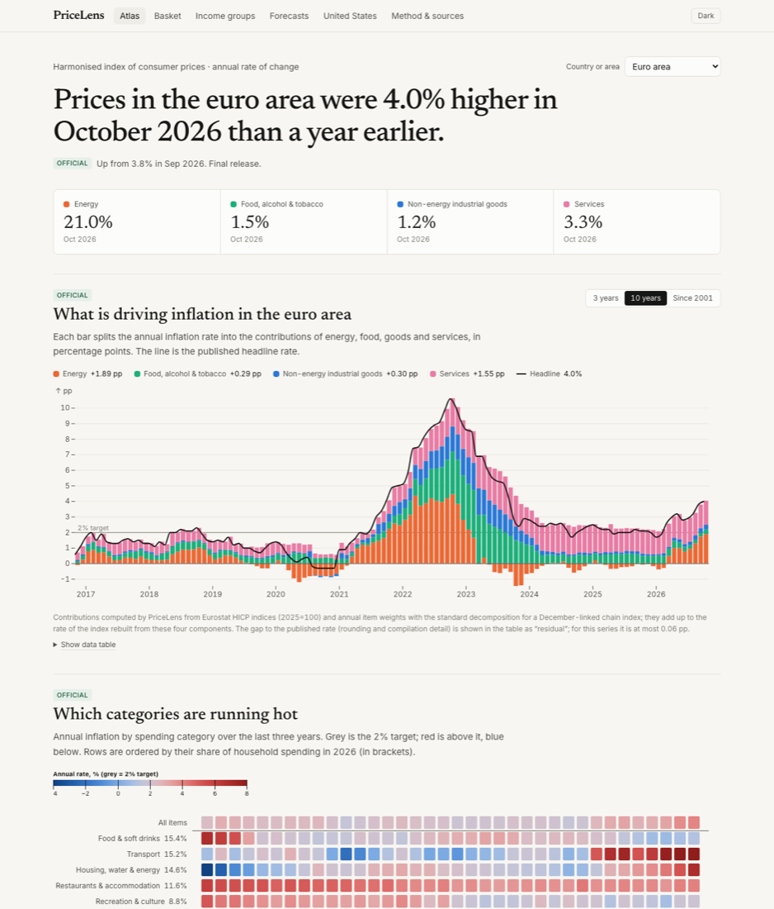
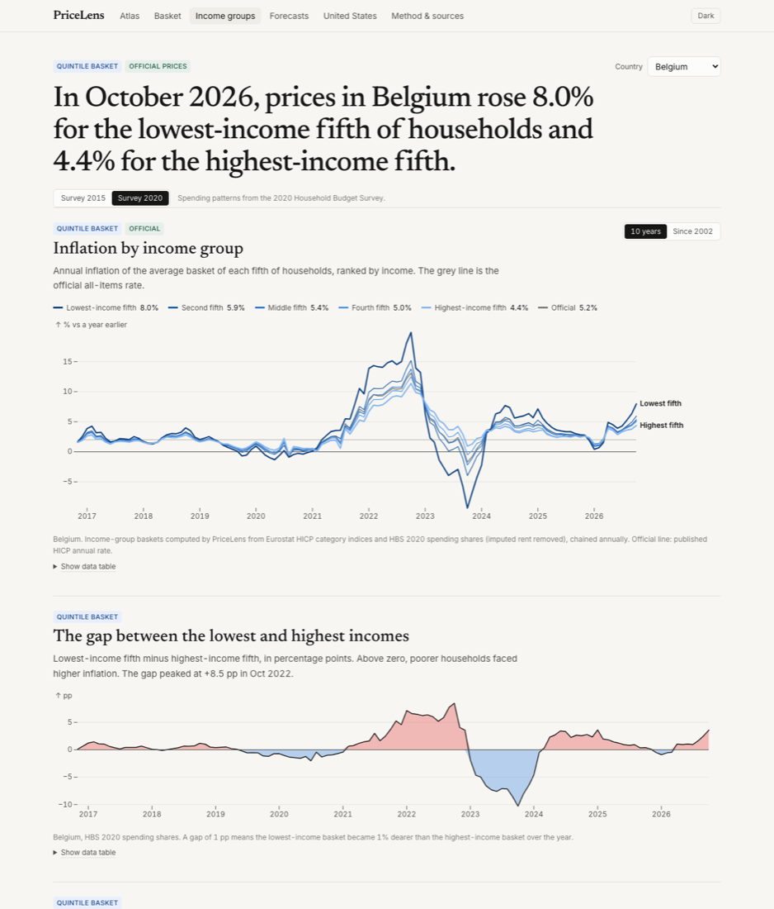
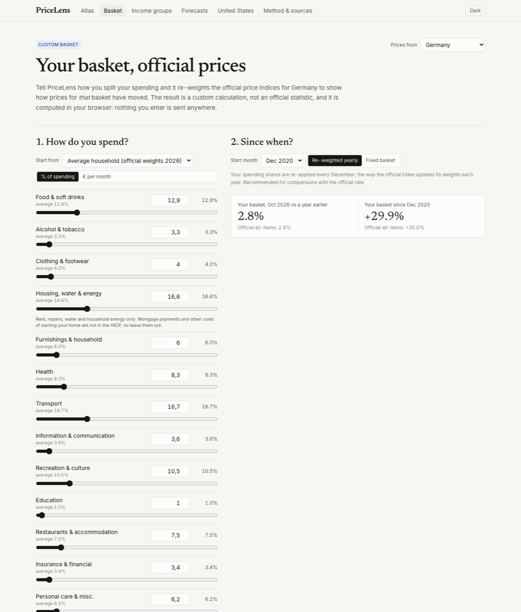
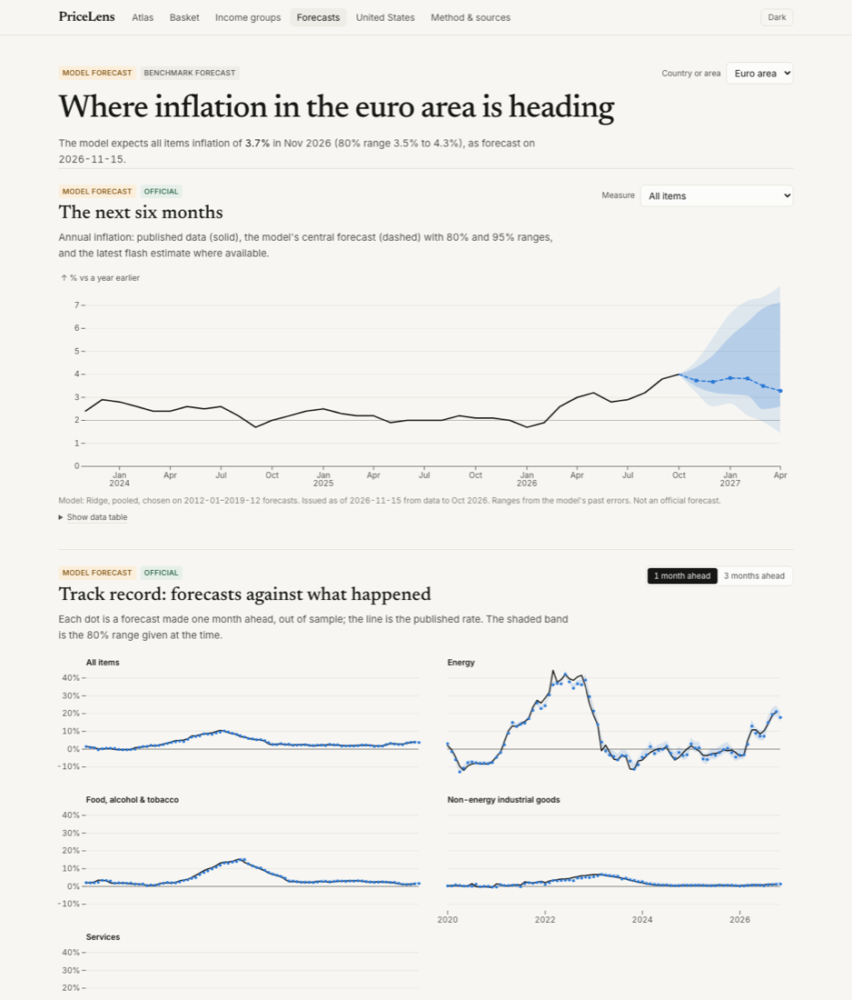
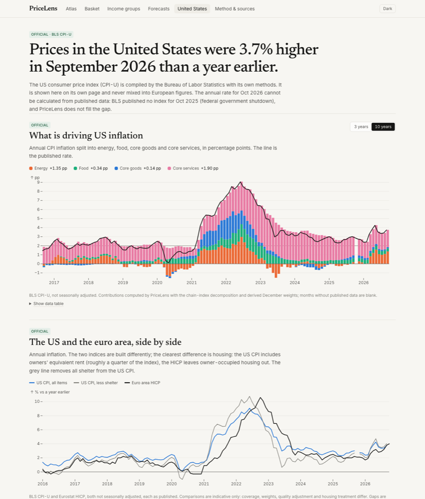

# PriceLens AI
### What is getting more expensive, for whom, where — and what comes next

**Status:** complete; the site runs locally as a static build and is not publicly hosted.

Inflation is reported as one headline number, but people buy different things. PriceLens is built on official Eurostat statistics. It shows:
- which categories drive inflation in each EU country;
- how inflation differs between the poorest and richest households, using official survey spending patterns;
- how prices have moved for *your own* spending basket, computed privately in your browser;
- where inflation is heading, with forecasts measured honestly against Eurostat's flash estimate and ECB staff projections.

Every number is labelled as official, flash estimate, custom basket, income-group basket, model forecast, benchmark forecast or hypothetical scenario.

| Atlas | Income groups |
|---|---|
|  |  |
| **Basket Studio** | **Forecast Lab** |
|  |  |
| **United States** | |
|  | |

## What it shows

- **Inflation Atlas.** The 27 EU countries, the euro area and the EU, monthly since 2000. It has:
  - the headline rate, with Eurostat's flash estimate when available;
  - contributions of energy, food, goods and services;
  - a 3-year category heatstrip centred on the 2% target;
  - a country ranking and map;
  - 13-category small multiples.
- **Basket Studio.** Enter spending shares or monthly euro amounts, either re-weighted yearly like the official index or as a fixed basket. Compare the price level and annual rate with the official index, see contributions since a start month, and run a labelled 12-month hypothetical scenario. Nothing you enter leaves the browser.
- **Income groups.** Inflation for each fifth of households by income in 25 countries, from Household Budget Survey spending shares (2015 and 2020 waves). It shows the gap between the lowest and highest income fifths and which categories drive it.
- **United States.** BLS CPI-U on its own page, never mixed with the HICP. It shows contributions of energy, food, core goods and core services (with derived December weights), the eight major groups, and a side-by-side view with the euro area that explains the housing difference.
- **Forecast Lab.** 1–6-month forecasts of the annual rate for the euro area, DE, FR, IT and ES (headline plus four components). It includes an out-of-sample track record, a model scoreboard, benchmarks and interval calibration.

## Key results

- **The maths reproduces the official index.**
  - Rebuilding the all-items HICP from Eurostat's 13 published category indices and annual weights, with the official December-linked chain formula, matches the published annual rate within 0.014–0.031 pp (95th percentile) for 28 of 29 series since 2001.
  - Italy is the documented exception; the hypothesis that its weights are not price-updated was tested and rejected ([`reports/qa.md`](reports/qa.md)).
  - The browser basket code passes the same check.
- **Who faces higher inflation differs by country.** In October 2026, with 2020 survey weights:
  - in Belgium the lowest-income fifth faced 8.0% inflation against 4.4% for the highest, almost entirely because of housing and energy;
  - in 10 of 21 countries the highest-income fifth currently faces *higher* inflation (Bulgaria −2.1 pp, Latvia −2.0 pp, Luxembourg −1.3 pp);
  - in 16 of 21 countries the gap is under 1 pp either way.
- **The forecasts beat simple rules but not the officials** ([`reports/forecast.md`](reports/forecast.md)). On the frozen 2020+ test period:
  - The chosen model, pooled ridge (picked on 2012–2019 forecasts only), errs by 0.77 pp one month ahead against 0.94 pp for the best simple rule, and by 1.73 against 2.05 pp three months ahead.
  - Eurostat's flash estimate, published two weeks after our forecast, errs by just 0.05 pp on the headline. ECB staff projections are also more accurate.
  - The ranges were too narrow in the 2020–23 shocks: 55–61% of outcomes fell inside the 80% range one month ahead.
- **What drives the forecasts, and what was rejected** ([`reports/advanced.md`](reports/advanced.md)):
  - Weekly pump prices from the Oil Bulletin carry the energy forecasts. Without oil, fuel and FX inputs, energy's gain over the seasonal rule falls from 25% to 5%.
  - Two ideas were rejected under the adoption rule (at least a 5% validation gain): a bottom-up headline (1.7% gain) and crisis-adaptive ranges.
  - The adaptive ranges would have helped in 2022–23 (74% coverage instead of 55%) but scored worse on the calm validation years.

## Run it

```bash
uv sync                          # Python 3.12 environment
uv run pricelens all             # fetch -> fetch-extra -> curate -> qa (gate) -> forecast -> advanced -> us -> export   (~8 min from scratch)
make test                        # ruff + pytest, then tsc, oxlint, vitest, build, Playwright smoke tests

cd app && npm install
npm run dev                      # the site at http://127.0.0.1:5174
npm run build                    # static build -> app/dist (relative paths; any static host)
```

Each step can also be run on its own:

| Command | What it does |
|---|---|
| `fetch` | Eurostat bulk snapshots into `data/raw/`, with a manifest carrying sha256 and licence |
| `audit` | Source audit report |
| `curate` | Parquet warehouse in `data/curated/` |
| `qa` | Data-contract checks and the reconstruction gate; fails the run on hard errors |
| `fetch-extra` | Flash history, Oil Bulletin, Brent, ECB |
| `forecast` | Rolling-origin backtest, benchmarks and live forecast |
| `advanced` | Ablations, hierarchical headline and interval experiments |
| `us` | US view from BLS CPI-U |
| `export` | Site data in `app/public/data/`, which is committed so the site builds without the pipeline |

The site data is committed, so `cd app && npm run build` works on a fresh clone. A full rebuild from the raw snapshots reproduces the forecasts and scores exactly.

## How it works

```text
Eurostat (HICP monthly + weights + first releases, HBS)  ·  Oil Bulletin  ·  EIA Brent  ·  ECB (EUR/USD, staff projections)
        │ immutable snapshots keyed by source version / content hash, licence recorded per file
        ▼
Python pipeline (uv, Polars, Parquet, statsmodels, scikit-learn)
  curate ─► QA gate (reconstruction of the official HICP) ─► contributions ─► income-group indices ─► forecasts
        │ compact JSON (≈4.5 MB)
        ▼
Static site (Vite, React, TypeScript, Tailwind v4, Observable Plot, d3) — basket maths runs in the browser
```

- **Index maths:** fixed-base and December-linked chained baskets; the standard contribution decomposition for chain indices; HBS shares with imputed rent removed, bridged from COICOP 1999 to ECOICOP ver. 2 and price-updated to every December.
- **Forecasting:**
  - Targets are the cumulative log change over 1–6 months, scored as annual-rate errors in percentage points.
  - Information is cut at the 15th of the month after the origin, and a test proves later data cannot leak in.
  - Models: simple rules, per-series SARIMA, and pooled ridge and gradient boosting (scikit-learn) learning deviations from the seasonal pattern.
  - Intervals are the spread of each model's own realised errors.
- **Quality:** 29 pipeline tests, 11 browser-maths tests and 22 Playwright smoke tests (desktop and phone: every page renders real charts with no console errors and no horizontal scroll; basket privacy; validation). CI and a monthly refresh workflow are in `.github/workflows/`. The refresh opens a pull request; nothing deploys automatically.

## Scientific boundaries

- **What price indices measure:** relative price change, not the euro cost of living. **The HICP excludes owner-occupied housing and mortgage interest;** the site says so wherever housing spending is entered.
- **Baskets are calculations, not statistics:** custom and income-group baskets are not official, and income-group shares are averages for large groups, not real households.
- **Forecasts:** they predict, they don't explain causes. History uses the current data vintage (the HICP is rarely revised), so backtests are pseudo-real-time.
- **Scenarios:** they are assumptions, not forecasts or policy counterfactuals.

## Data and attribution

- **Eurostat**, © European Union (`prc_hicp_minr`, `prc_hicp_iw`, `prc_hicp_fpd`, `prc_hicp_fp`, `hbs_str_t223`): reused under the Eurostat copyright notice. Data were transformed by PriceLens; Eurostat bears no responsibility for the results.
- **European Commission, Weekly Oil Bulletin** (CC BY 4.0): forecast input only, not republished.
- **U.S. Energy Information Administration**, Brent spot price (public domain): forecast input only, not republished.
- **ECB:** EUR/USD reference rate ("Source: ECB statistics"), used only for currency conversion. Eurosystem/ECB staff projections are used as a benchmark; only PriceLens's own error statistics are shown.
- **U.S. Bureau of Labor Statistics**, CPI-U (public domain). BLS.gov cannot vouch for the data or analyses derived from these data after the data have been retrieved from BLS.gov.
- **Map boundaries:** Made with Natural Earth (public domain), via world-atlas (ISC).

The terms, required credits and what is adapted from each source are set out in [DATA_LICENSES.md](DATA_LICENSES.md).

## Licence

The code is released under the [MIT License](LICENSE). The data and figures derived from the sources above stay under their own terms ([DATA_LICENSES.md](DATA_LICENSES.md)). Bundled third-party assets (map data, fonts) carry their licences in [LICENSES/](LICENSES/).

## Documents

- [Data contract](docs/DATA_CONTRACT.md): sources, grain, formulas and labelling
- [Data licences](DATA_LICENSES.md): terms and attributions for every source
- Reports: [source audit](reports/source_audit.md) · [data QA](reports/qa.md) · [forecast benchmark](reports/forecast.md) · [advanced models](reports/advanced.md) · [United States](reports/us.md)
